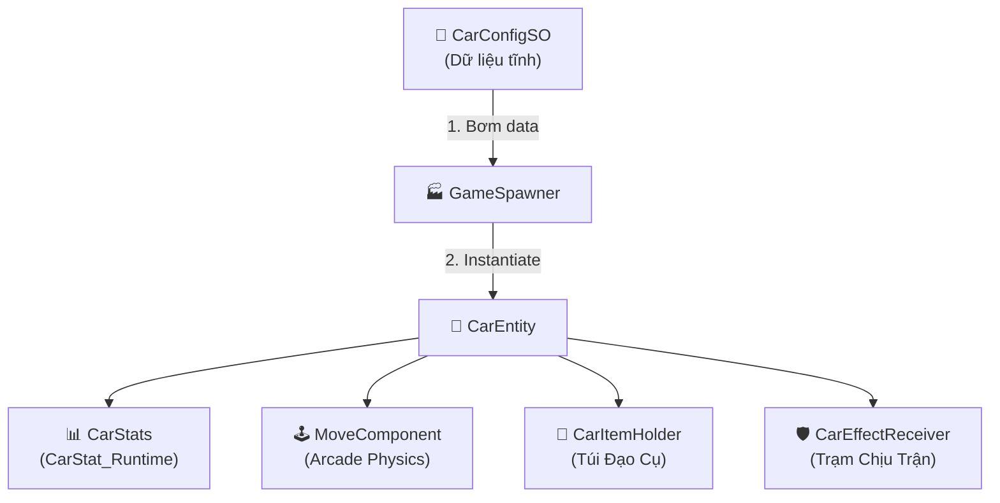
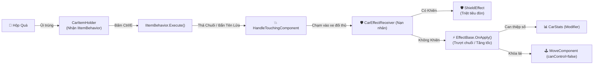

# 🏎️ ZINGSPEED ITEM RACING 3D — SYSTEM ARCHITECTURE & CODEBASE
> **Tài liệu Kiến Trúc Hệ Thống & Toàn Bộ Mã Nguồn C# Unity Chế Độ Đua Đạo Cụ (Item Racing System)**  
> *Dự án*: 3D Arcade Kart Racing (ZingSpeed / Mario Kart style)  
> *Engine*: Unity C# (Data-Driven, Strategy Pattern, Master-Worker Effect Lifecycle, Arcade Drift Physics)

---

## 📑 MỤC LỤC
1. [Tổng Quan Kiến Trúc](#1-tổng-quan-kiến-trúc)
2. [Sơ Đồ Kiến Trúc Hệ Thống (Architectural Diagram)](#2-sơ-đồ-kiến-trúc-hệ-thống)
3. [Bản Đồ Thư Mục & 20 Lớp Cốt Lõi (File Map)](#3-bản-đồ-thư-mục--20-lớp-cốt-lõi)
4. [Chi Tiết Thực Thi Từng Module](#4-chi-tiết-thực-thi-từng-module)
   - [A. Dữ Liệu & Chỉ Số (Data & Stats)](#a-dữ-liệu--chỉ-số-data--stats)
   - [B. Thực Thể Xe & Vật Lý Lái (Entity & Movement)](#b-thực-thể-xe--vật-lý-lái-entity--movement)
   - [C. Hệ Thống Đạo Cụ Tấn Công (Items System)](#c-hệ-thống-đạo-cụ-tấn-công-items-system)
   - [D. Hệ Thống Chịu Trận & Hiệu Ứng (Effects System)](#d-hệ-thống-chịu-trận--hiệu-ứng-effects-system)
   - [E. Va Chạm & Vòng Lặp Trận Đua (Combat & Core Loop)](#e-va-chạm--vòng-lặp-trận-đua-combat--core-loop)

---

## 1. TỔNG QUAN KIẾN TRÚC

Hệ thống được thiết kế theo 4 trụ cột kiến trúc cốt lõi:

```
┌────────────────────────────────────────────────────────────────────────┐
│ 1. DATA-DRIVEN ARCHITECTURE                                           │
│    - CarConfigSO: File cấu hình tĩnh xuất xưởng lưu trên ổ cứng.       │
│    - CarStat_Runtime & CarStats: Cỗ máy tính toán chỉ số thời gian thực│
│      hỗ trợ cộng dồn Buff/Debuff (StatModifier) mà không bị đè số.     │
├────────────────────────────────────────────────────────────────────────┤
│ 2. STRATEGY PATTERN (Hệ thống Đạo Cụ Tấn Công)                         │
│    - IItemBehavior: Interface hành vi độc lập cho từng món đồ.         │
│    - BananaBehavior, NitroBehavior, MissileBehavior tự thực thi logic. │
│    - CarItemHolder: Ô chứa túi đồ trên xe, không cần switch-case.      │
├────────────────────────────────────────────────────────────────────────┤
│ 3. MASTER - WORKER PATTERN (Hệ thống Chịu Trận & Hiệu Ứng)             │
│    - CarEffectReceiver (Master): Cai ngục nuôi danh sách, đếm ngược    │
│      thời gian và lọc cửa ngõ (check Khiên ShieldEffect).              │
│    - EffectBase (Worker): Lớp cha quản lý vòng đời (Init, OnApply,     │
│      OnUpdate, OnRemove) cho các hiệu ứng cụ thể.                      │
├────────────────────────────────────────────────────────────────────────┤
│ 4. ARCADE KART PHYSICS (Vật lý Lái ZingSpeed)                          │
│    - Raycast kiểm tra mặt dốc và ép downforce không bị lật xe.         │
│    - Cơ chế Drift (Shift): Bẻ cua góc hẹp, văng đuôi xe qua Lerp,      │
│      tích thanh Nitro và phụt Mini-Boost khi nhả phím.                 │
└────────────────────────────────────────────────────────────────────────┘
```

---

## 2. SƠ ĐỒ KIẾN TRÚC HỆ THỐNG

### 🏁 Luồng Khởi Tạo & Vận Hành Xe


### 💥 Luồng Tấn Công, Va Chạm & Chịu Trận


---

## 3. BẢN ĐỒ THƯ MỤC & 20 LỚP CỐT LÕI

Toàn bộ mã nguồn nằm trong thư mục `Scripts/`:

```text
Scripts/
├── Data/
│   ├── CarConfigSO.cs          # ScriptableObject lưu thông số tĩnh xuất xưởng
│   ├── StatModifier.cs         # Class biểu diễn lượng cộng/trừ chỉ số (Buff/Debuff)
│   ├── CarStat_Runtime.cs      # Quản lý 1 chỉ số runtime đơn lẻ (tính con số thực tế)
│   └── CarStats.cs             # Component gom các RuntimeStat trên xe
├── Entity/
│   ├── CarEntity.cs            # Thực thể tổng tư lệnh chiếc xe
│   └── MoveComponent.cs        # Vật lý điều khiển lái, drift, leo dốc, mini boost
├── Items/
│   ├── IItemBehavior.cs        # Interface chiến thuật kích hoạt đạo cụ
│   ├── BananaBehavior.cs       # Đạo cụ thả vỏ chuối sau đuôi xe
│   ├── NitroBehavior.cs        # Đạo cụ phụt lửa tăng tốc
│   ├── MissileBehavior.cs      # Đạo cụ bắn tên lửa tầm nhiệt đuổi xe phía trước
│   └── CarItemHolder.cs        # Quản lý ô túi đồ trên xe và bắt phím sử dụng
├── Effects/
│   ├── EffectBase.cs           # Lớp cha vòng đời hiệu ứng (Init, Apply, Update, Remove)
│   ├── CarEffectReceiver.cs    # Quản lý danh sách hiệu ứng trên xe, check Khiên
│   ├── BananaSlipEffect.cs     # Hiệu ứng trượt chuối mất lái xoay 360 độ
│   ├── NitroSpeedEffect.cs     # Hiệu ứng tăng tốc nạp Modifier vào CarStats
│   └── ShieldEffect.cs         # Hiệu ứng khiên bảo vệ triệt tiêu đòn đánh
├── Combat/
│   └── HandleTouchingComponent.cs # Bắt va chạm OnTrigger cho Hộp Quà, Chuối, Bẫy
└── Core/
    ├── GameEvents.cs           # Event Bus toàn cục kết nối lỏng lẻo hệ thống
    ├── GameSpawner.cs          # Xưởng sinh xe lên đường đua từ CarConfigSO
    └── GameManager.cs          # Quản lý trạng thái trận đua, vòng lap và map
```

---

## 4. CHI TIẾT THỰC THI TỪNG MODULE

### A. Dữ Liệu & Chỉ Số (Data & Stats)
* **`CarConfigSO`**: Lưu các giá trị xuất xưởng (`topSpeed = 35f`, `acceleration = 2500f`, `driftGrip = 2f`, `normalGrip = 14f`).
* **`StatModifier`**: Định nghĩa loại sửa đổi (`Flat` số tuyệt đối hoặc `Percent` phần trăm).
* **`CarStat_Runtime`**: Quản lý từng chỉ số động:
  $$\text{CurrentValue} = (\text{Base} + \text{FlatModifiers}) \times (1 + \text{PercentModifiers})$$
* **`CarStats`**: Nắm giữ bảng tra cứu Dictionary cho các `StatType` (`TopSpeed`, `Acceleration`, `DriftGrip`, `Health`).

### B. Thực Thể Xe & Vật Lý Lái (Entity & Movement)
* **`CarEntity`**: Cầu nối trung tâm sở hữu các component: `stats`, `movement`, `itemHolder`, `effectReceiver`.
* **`MoveComponent`**: 
  * Áp dụng lực gia tốc `AddForce(forward * input * accel)` bị giới hạn bởi `maxSpeed` lấy từ `CarStats`.
  * Raycast kiểm tra mặt đất, tính pháp tuyến `hit.normal` và ép lực `downforce = 1500f`.
  * Chế độ Drift (`LeftShift`): Xoay góc gắt hơn (`turnSpeed * 2f`), chuyển giao vận tốc theo `driftGrip` và nạp thanh năng lượng `nitro`.
  * Nhả Drift: Tự động kích hoạt `TriggerMiniBoost()`.
  * Phím `Space`: Xả bình Nitro lớn `UseFullNitro()`.
  * Cờ `canControl`: Cho phép các hiệu ứng bên ngoài khóa phím điều khiển khi xe bị dính đòn.

### C. Hệ Thống Đạo Cụ Tấn Công (Items System)
* **`IItemBehavior`**: Interface mẫu chuẩn với phương thức `Execute(CarEntity user)`.
* **`BananaBehavior`**: Sinh Prefab vỏ chuối ngay sau vị trí `dropPoint` của xe.
* **`NitroBehavior`**: Nạp `NitroSpeedEffect` vào `effectReceiver` của chính người dùng.
* **`MissileBehavior`**: Quét danh sách xe trên đường đua bằng tích vô hướng góc nhìn `Vector3.Dot > 0.4f` để khóa mục tiêu phía trước và bắn.
* **`CarItemHolder`**: Lắng nghe phím `LeftControl` hoặc `E` để xài đồ, dùng xong tự dọn ô đồ về `null` và báo `GameEvents.OnItemSlotUpdated`.

### D. Hệ Thống Chịu Trận & Hiệu Ứng (Effects System)
* **`EffectBase`**: C# Class thuần quản lý thời gian tồn tại `remainingDuration`, trừ dần qua `OnUpdate(deltaTime)` và kích hoạt `OnRemove()` khi hết hạn.
* **`CarEffectReceiver`**: 
  * Khi nhận đòn: Kiểm tra `HasEffect<ShieldEffect>()`. Nếu xe có Khiên thì phá hủy Khiên và hủy đòn đánh.
  * Nuôi dưỡng và cập nhật thời gian cho danh sách `activeEffects` trong `Update()`.
* **`BananaSlipEffect`**: Gán `movement.canControl = false` và gọi `movement.Spin360Degrees()`. Hết giờ tự bật lại tay lái.
* **`NitroSpeedEffect`**: Nạp `StatModifier` tăng tốc vào `stats`, hết giờ tự gỡ bỏ.
* **`ShieldEffect`**: Đóng vai trò lớp giáp vô hiệu hóa đòn tấn công tiếp theo.

### E. Va Chạm & Vòng Lặp Trận Đua (Combat & Core Loop)
* **`HandleTouchingComponent`**: Xử lý va chạm `OnTriggerEnter`:
  * Đối với `ItemBox`: Cấp ngẫu nhiên đạo cụ cho `CarItemHolder` và ẩn hộp quà.
  * Đối với `BananaTrap`: Nạp `BananaSlipEffect` vào `CarEffectReceiver` của xe dẫm phải.
* **`GameEvents`**: Trạm phát sóng tĩnh kết nối `OnCarSpawned`, `OnItemSlotUpdated`, `OnLapCompleted`, `OnRaceStarted`, `OnRaceFinished`.
* **`GameSpawner`**: Tạo xe từ `CarConfigSO`, gắn `CarEntity` và tiêm dữ liệu qua `Init()`.
* **`GameManager`**: Singleton khởi động cuộc đua, điều phối Spawner và quản lý số vòng thi đấu.

---
*Tài liệu phản ánh 100% cấu trúc thực tế tại kho lưu trữ [tqt20004/paper_for_code-RaceGame3D_Unity-](https://github.com/tqt20004/paper_for_code-RaceGame3D_Unity-).*
